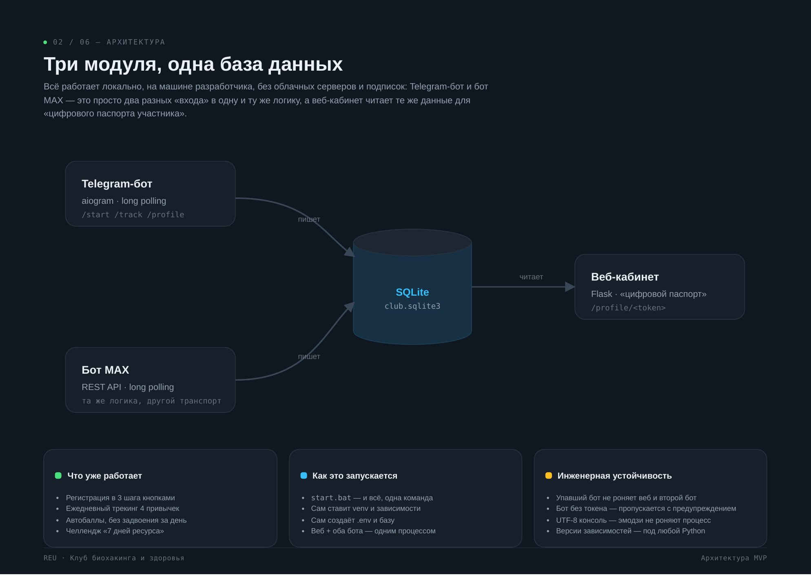
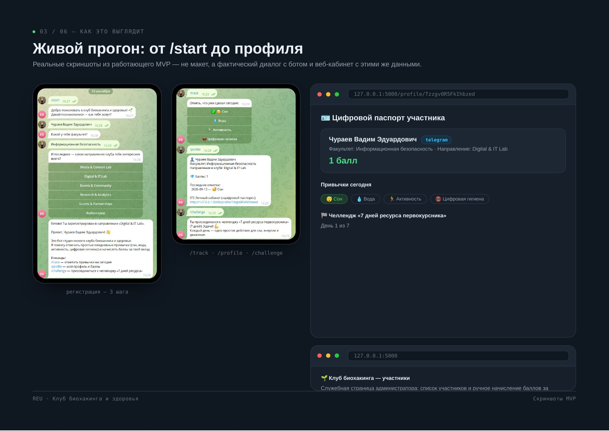

## Задача

Студенческому клубу биохакинга и здоровья в РЭУ им. Г. В. Плеханова нужна цифровая инфраструктура: регистрировать участников, отмечать привычки, начислять баллы за вклад в сообщество и показывать каждому его прогресс. Без учёта баллов принцип клуба «измеримый вклад» оставался бы только на бумаге.

## Решение

Три модуля работают с одной базой SQLite:

- **Telegram‑бот** (aiogram) — регистрация в три шага, ежедневные отметки привычек кнопками, челленджи.
- **Бот MAX** (REST API, aiohttp) — та же логика, общий профиль участника в обоих мессенджерах.
- **Веб‑кабинет** (Flask) — «цифровой паспорт участника»: баллы, история привычек, статус челленджа. Каждому участнику бот присылает персональную ссылку.

### Конкурсы без двойных баллов

Администратор создаёт конкурс прямо в боте: задания и награда в баллах. Конкурс сразу публикуется в Telegram и MAX одной записью в базе, без дублей. Участники отправляют выполненные задания на проверку, администратор подтверждает, и баллы начисляются один раз, даже при повторных нажатиях.

## Результат

Рабочий MVP, показанный клубу на реальных данных. Вся система поднимается одной командой (`start.bat` или `start.sh`): скрипт сам создаёт окружение, ставит зависимости, готовит базу и запускает оба бота и веб‑кабинет. Для продакшена есть инструкция по развёртыванию на сервере как systemd‑сервис.

<!-- TODO: сколько участников пользуется, что дальше -->
