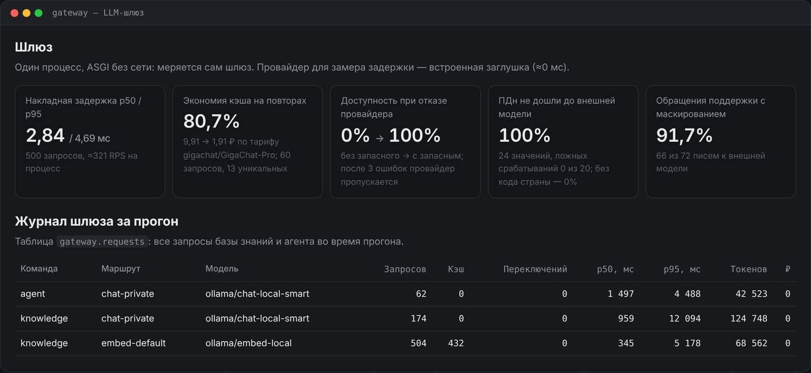

## Задача

Когда моделями пользуются несколько команд и сервисов, без общего входа быстро начинается хаос: ключи API разбросаны по коду, траты никто не контролирует, персональные данные клиентов уходят во внешние сервисы, а падение одного провайдера кладёт все ИИ‑функции компании.

Шлюз — первый и центральный сервис платформы **Inopia**: единственная дверь, через которую база знаний, агент и любые другие сервисы обращаются к моделям. Его главная задача — сделать так, чтобы **по умолчанию всё работало на локальных моделях** внутри компании, а облако подключалось только там, где это разрешено и безопасно.

## Как это работает

<b>Путь запроса через шлюз</b>OpenAI‑совместимый API

<i class="dg-num">1</i><b>Запрос</b>сервис или команда со своим ключом

<i class="dg-num">2</i><b>Ключ и лимиты</b>команда, бюджет в месяц, запросов в минуту

<i class="dg-num">3</i><b>Маршрут</b>роль → список моделей по порядку

<i class="dg-num">4</i><b>Кэш</b>одинаковый вопрос — ответ без модели

<i class="dg-num">5</i><b>Модель</b>ответ + журнал: кто, сколько, за сколько

<b>chat-private</b>конфиденциальные запросы: база знаний, агент<i class="dg-tag is-red">только Ollama · Qwen 2.5 7B</i>

<b>embed-default</b>векторы для поиска по документам<i class="dg-tag is-red">только Ollama · bge‑m3</i>

<b>chat-fast</b>несекретные задачи, где важна доступность<i class="dg-tag">Ollama</i><i class="dg-tag">→ YandexGPT</i><i class="dg-tag">→ GigaChat</i>

<i class="is-red"></i>никогда не покидает контур<i></i>облако — запасной путь, ПДн маскируются перед отправкой

Клиент просит не конкретную модель, а **роль** — `chat-private`, `chat-fast`, `embed-default`. Какая модель за ней стоит, решает конфигурация шлюза: можно заменить Qwen на другую модель или добавить облачный запасной вариант, не трогая ни одного сервиса. В заголовках ответа шлюз сообщает, кто ответил, во сколько это обошлось, было ли попадание в кэш и переключение на запасного провайдера.

### Маскирование персональных данных

Если запрос всё‑таки уходит во внешнюю модель, шлюз заменяет персональные данные метками, а в ответе возвращает их обратно — модель так и не видит настоящих значений:

<b>Исходный текст</b>«Звоните +7 916 123‑45‑67, СНИЛС 112‑233‑445 95, инвертор SI10‑2025‑00417»

<b>Уходит в облако</b>«Звоните [PHONE_1], СНИЛС [SNILS_1], инвертор SI10‑2025‑00417»

<b>Возвращается сотруднику</b>метки заменены обратно на настоящие значения

Почта, телефоны, банковские карты (проверка по алгоритму Луна), СНИЛС и ИНН (контрольные суммы), паспорта — маскируются; серийные номера, номера договоров и коды ошибок — нет, иначе модель не поймёт обращение.

### Работа на одной видеокарте

На ноутбуке с RTX 3060 (6 ГБ) Qwen 2.5 7B в 4‑битной квантизации и bge‑m3 помещаются в видеопамять одновременно. Чтобы не держать две чат‑модели, оба чат‑маршрута по умолчанию обслуживает одна модель, а запросы к Ollama идут по одному — шлюз добавляет к ответу модели всего ~3 мс.

## Ключевые инженерные решения

- **Маршрут — это и политика стоимости, и политика отказоустойчивости.** Ошибки 5xx/429/сеть/таймаут → следующая модель; 400/422 не повторяются. Предохранитель: после трёх ошибок подряд провайдер пропускается на 30 секунд, чтобы не тратить время на заведомо мёртвый.
- **Конфиденциальное — только локально, на уровне конфигурации.** Маршрут `chat-private` не содержит облачных провайдеров в принципе, а модель для базы знаний задаётся настройкой сервиса, а не клиентом API: даже ошибка в коде не отправит закрытый документ наружу.
- **ПДн маскируются только для внешних провайдеров.** Для локальной модели это не нужно и только ухудшило бы ответ; для команд с чувствительными данными (кадры) — маскирование всегда.
- **Кэш по точному совпадению и только для детерминированных запросов** (`temperature ≤ 0,2`). Семантический кэш отложен намеренно: риск вернуть ответ на похожий, но другой вопрос.
- **Журнал без текстов запросов по умолчанию**, запись фоном пачками — запрос не ждёт базу, а в журнале нет персональных данных.

## Что внутри

- OpenAI‑совместимый API: `/v1/chat/completions` (включая потоковые ответы и `tools`), `/v1/embeddings`, `/v1/models`, а также `/v1/usage` — траты команды за месяц.
- Провайдеры: Ollama и любые OpenAI‑совместимые серверы (vLLM), GigaChat, YandexGPT.
- FastAPI, Redis (лимиты, кэш), PostgreSQL (журнал), 55 автотестов, CI.

## Метрики

<!-- inopia:metrics:start -->
> Живой прогон 31.10.2026 (коммит `a89d1d3`): чат `qwen2.5:7b-instruct`, эмбеддинги `bge-m3` через Ollama; 11th Gen Intel(R) Core(TM) i5-11400H @ 2.70GHz, 16 ГБ ОЗУ, NVIDIA GeForce RTX 3060 Laptop GPU, 6144 MiB.

| Метрика | Значение |
|---|---|
| Накладная задержка p50 / p95 | 2,84 / 4,69 мс, ≈321 RPS на процесс |
| Доступность, первый провайдер маршрута недоступен | без запасного 0% → с запасным 100% |
| Кэш на потоке вопросов сотрудников (60 запросов, 13 уникальных) | попаданий 78,3%, 9,91 → 1,91 ₽ по тарифу gigachat/GigaChat-Pro |
| ПДн поддерживаемых форматов (почта, телефон, карта, СНИЛС, ИНН, паспорт) | 100% из 24, ложных срабатываний 0 из 20 |
| Телефоны без кода страны | 0% — известное ограничение |
| Обращения поддержки, замаскированные перед внешней моделью | 91,7% (66 из 72) |
<!-- inopia:metrics:end -->

Замеры — шлюз в одном процессе, без сети: задержка — на встроенной заглушке провайдера, отказ — на закрытом порту, ПДн — по тексту, который получил провайдер. Поток для кэша синтетический (распределение Ципфа по вопросам сотрудников), поэтому экономия зависит от доли повторов в реальной нагрузке.

## Ограничения

- Телефоны без кода страны и ФИО не маскируются — нужны словари или NER‑модель.
- `tools` пока транслируются только в модели с поддержкой функций (Qwen через Ollama), не в GigaChat и YandexGPT.
- Бюджеты считаются в процессе; для нескольких реплик нужен общий счётчик в Redis.
