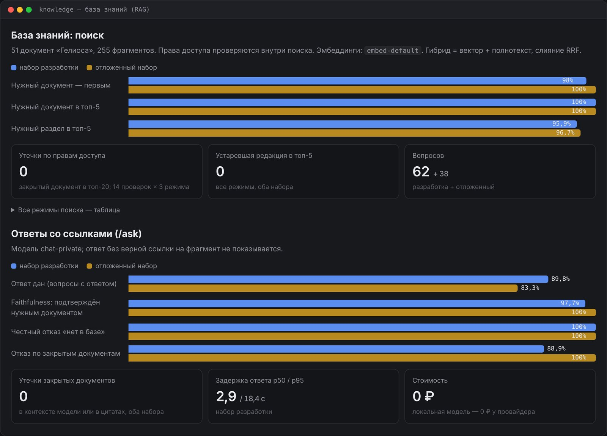

## Задача

Сотрудники ищут ответы в десятках регламентов: как оформить отпуск, сколько действует гарантия, кто согласует договор. Обычный чат‑бот по документам в компании опасен по двум причинам: он **уверенно придумывает** и может **пересказать то, что спрашивающему видеть нельзя** — оклады, финансовую отчётность, кадровые решения.

База знаний — второй сервис платформы **Inopia**. Она отвечает только по документам, со ссылкой до конкретного абзаца, уважает права доступа и честно говорит «не нашёл», когда ответа нет. И поиск, и ответы работают на **локальных моделях**: ни один документ компании не уходит во внешний API.

## Как это работает

<b>Путь вопроса</b>bge‑m3 и Qwen 2.5 7B — локально через шлюз

<i class="dg-num">1</i><b>Вопрос</b>сотрудник и его группы доступа

<i class="dg-num">2</i><b>Фильтр прав</b>условие внутри SQL: чужих документов для поиска не существует

<i class="dg-num">3</i><b>Поиск по смыслу</b>векторы bge‑m3 в pgvector

<b>Поиск по словам</b>полнотекст: коды E09, «СИ‑10»

<i class="dg-num">4</i><b>Слияние</b>RRF → 5 лучших фрагментов

<i class="dg-num">5</i><b>Ответ модели</b>Qwen 2.5 7B локально, только по найденным фрагментам

<i class="dg-num">6</i><b>Проверка</b>ссылки на реальные фрагменты, числа сверяются с цитатой, «тот ли вопрос»

<b>Ответ с цитатами</b>«Заявление на отпуск подаётся в СЭД не позднее чем за 14 календарных дней…» — «Положение об ежегодных отпусках», раздел «3.1 Заявление»

<b>«Не нашёл ответа в доступных вам документах»</b>одинаково, если ответа нет и если документ закрыт

### Пример: один вопрос — два сотрудника

<b>Специалист по кадрам</b>группы: all, hr, hr‑confidential«Какая вилка оклада у грейда G3?»<i class="dg-tag">ответ со ссылкой на «Грейды и вилки окладов»</i>

<b>Рекрутер</b>группы: all, hr«Какая вилка оклада у грейда G3?»<i class="dg-tag is-red">«Не нашёл…» — документ закрыт, и это не раскрывается</i>

Для рекрутера документа «Грейды и вилки окладов» просто не существует: её нет ни в выдаче поиска, ни в контексте модели, а запрос документа напрямую отвечает 404. Поэтому модель не может «проговориться», даже если её об этом попросить.

### Подготовка документов

51 документ «Гелиоса» с YAML‑шапкой (отдел, группы доступа, редакция, статус) режется по разделам — около 900 символов, фрагмент не пересекает границу раздела, поэтому цитата всегда указывает на конкретный абзац. Принимаются Markdown, TXT, DOCX и PDF с текстовым слоем. Тот же поиск доступен агенту поддержки через MCP‑сервер — от имени служебной учётной записи с правами только на документы поддержки.

## Ключевые инженерные решения

- **Права — условие внутри поискового SQL, а не фильтр после.** Закрытый фрагмент не попадает ни в выдачу, ни в контекст модели; чужой документ отвечает 404 — даже факт его существования не раскрывается.
- **Гибрид с RRF.** Вектор понимает перефразировки, но не видит коды «E09» и «СИ‑10»; полнотекст — наоборот. Слияние по рангам не требует калибровки шкал. С локальной bge‑m3 нужный документ попадает в топ‑5 в 100% случаев против 93–98% у одного полнотекста.
- **Ответу не доверяют, его проверяют.** Ссылки на несуществующие фрагменты вычищаются, ответ без верной ссылки не показывается, числа сверяются с цитатой. Цитата — дословный текст документа, а не пересказ модели. Вторым коротким вызовом модель проверяет, что процитированный фрагмент отвечает именно на этот вопрос, а не на соседний.
- **Одинаковый отказ для «нет в базе» и «закрыто»** — различие раскрыло бы закрытый документ.
- **Модель ответов задаёт конфигурация, а не клиент.** В контексте бывают конфиденциальные фрагменты, поэтому ответы всегда идут через локальный маршрут `chat-private`.
- **Утратившие силу редакции** остаются в базе для истории, но по умолчанию не выдаются.

## Что внутри

- API: `POST /documents` (загрузка с метаданными), `POST /search`, `POST /ask`; пользователь — в заголовке `X-User-Id`.
- MCP‑сервер `knowledge-mcp` с инструментами `search_documents` и `ask_knowledge_base` для агентов.
- FastAPI, PostgreSQL + pgvector (HNSW, косинус), полнотекстовый поиск по русскому словарю; 63 автотеста и 8 тестов MCP.

## Метрики

<!-- inopia:metrics:start -->
> Живой прогон 31.10.2026 (коммит `a89d1d3`): чат `qwen2.5:7b-instruct`, эмбеддинги `bge-m3` через Ollama; 11th Gen Intel(R) Core(TM) i5-11400H @ 2.70GHz, 16 ГБ ОЗУ, NVIDIA GeForce RTX 3060 Laptop GPU, 6144 MiB.

Вопросов: 62 в наборе разработки и 38 в отложенном; гибридный поиск, эмбеддинги `embed-default`.

| Метрика | Набор разработки | Отложенный набор |
|---|---|---|
| Нужный документ первым | 98% | 100% |
| Нужный документ в топ‑5 | 100% | 100% |
| Нужный раздел в топ‑5 | 95,9% | 96,7% |
| Закрытый документ в выдаче (все режимы) | 0 | 0 |
| /ask: ответ дан | 89,8% | 83,3% |
| /ask: faithfulness (ответ подтверждён нужным документом) | 97,7% | 100% |
| /ask: честный отказ, когда ответа нет | 100% | 100% |
| /ask: утечки в контекст модели | 0 | 0 |
| /ask: задержка p50 | 2,9 с | 2,2 с |
<!-- inopia:metrics:end -->

## Ограничения

- На вопрос о закрытом документе модель 7B иногда отвечает похожим фактом из доступного: «окончательный расчёт при увольнении» — датой обычной выплаты зарплаты из FAQ. Утечки нет, но ответ неверный; проверка «тот ли вопрос» ловит часть таких случаев и иногда отклоняет верные ответы.
- `confidence` — эвристика (покрытие ссылками, оценка поиска, подтверждённость чисел), не откалиброванная вероятность.
- Если неправда записана в самом документе, проверка её не поймает.
- PDF без текстового слоя отклоняется: распознавание сканов не входит в MVP.
