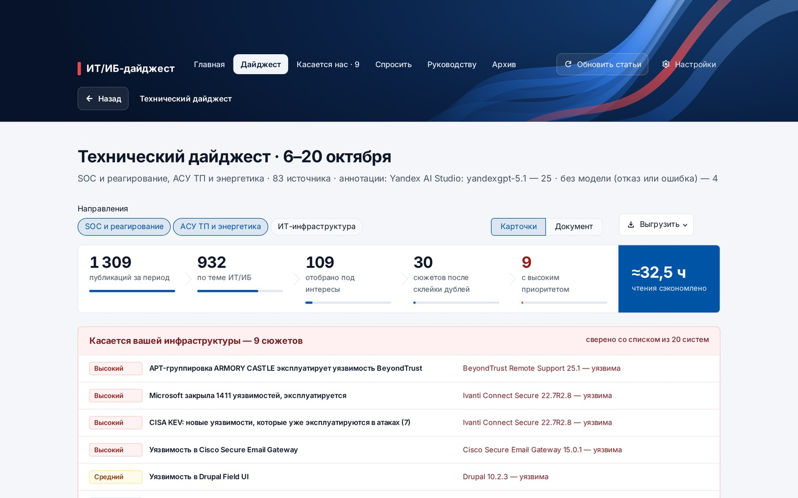
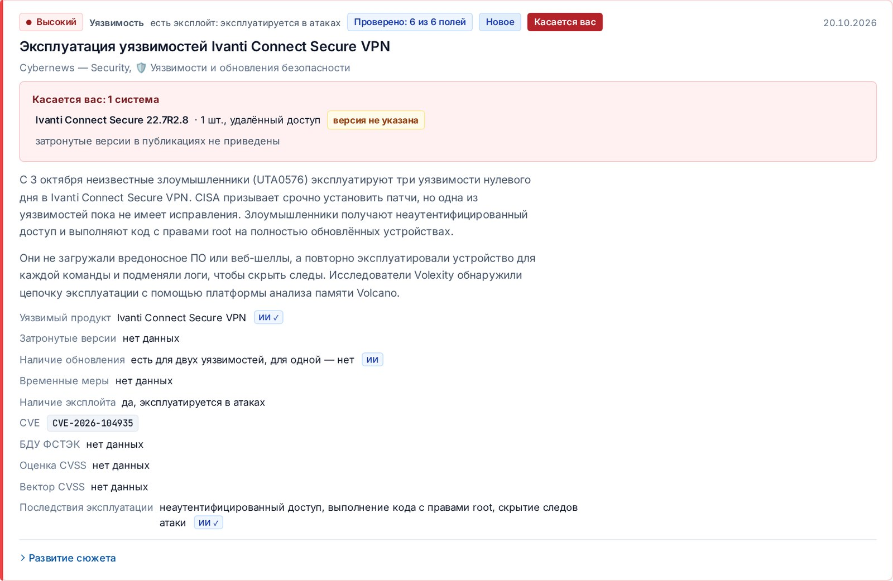
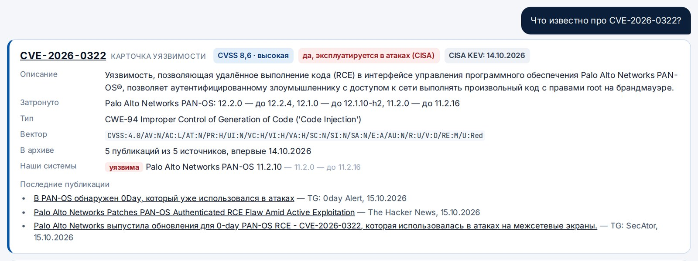
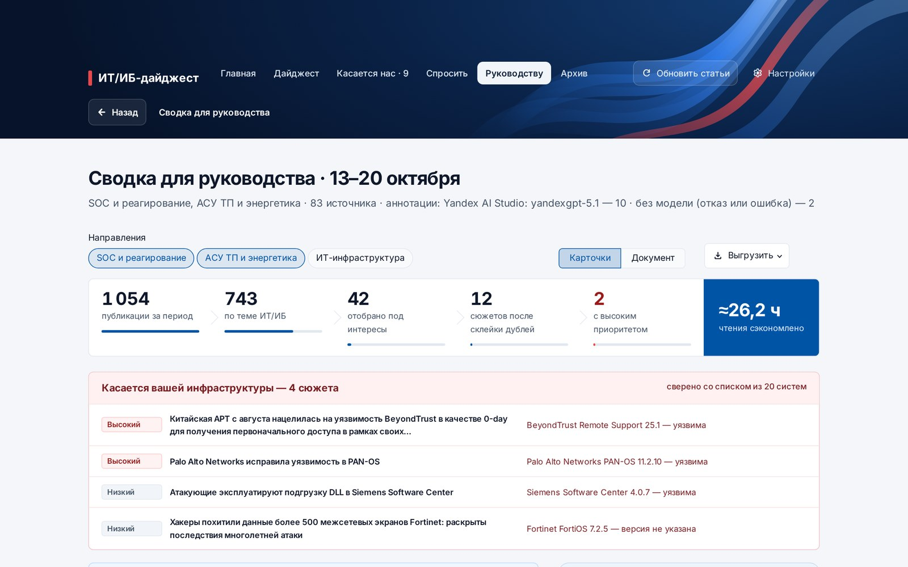

## Задача

Специалисты ИТ и ИБ энергокомпании каждый день просматривают десятки лент и Telegram‑каналов: отсеивают лишнее, ищут дубли, проверяют, касается ли новость их систем, и сводят всё в отчёт. Это часы ручной работы. Общие агрегаторы не знают ни специфики энергетики (АСУ ТП, КИИ, российский контекст), ни того, что установлено в компании.

Трек хакатона «ИИ‑ассистенты для энергетики» от Интер РАО и Codenrock: сделать ассистента, который автоматизирует этот цикл.

## Решение

Ассистент проходит весь путь сам: **источники → отбор → склейка дублей → карточки → сверка с системами компании → дайджест → рассылка**.

- **84 источника на двух языках:** СМИ по ИБ, вендоры, НКЦКИ, БДУ ФСТЭК, CISA KEV, 18 Telegram‑каналов. Сбор параллельный, в архив попадают только новые статьи.
- **Отбор под интересы читателя** с объяснением каждого решения. Подборка учится на оценках «полезно», «не по теме», «мало деталей».
- **Склейка дублей RU↔EN:** публикации разных СМИ об одном событии становятся одним сюжетом.
- **Карточки «Атака / Уязвимость / Инфо»** по схеме заказчика. CVSS, версии и признак эксплуатации берутся из cve.org и CISA, номер БДУ — из записей ФСТЭК.
- **«Касается нас».** Список ПО компании сверяется с затронутыми версиями: «уязвима», «не затронута», «версия не указана».

### Модель ИИ — помощник, а не источник фактов

Каждое значение, которое предлагает модель, сверяется с публикациями и реестрами. Неподтверждённое отбрасывается, а в карточке видно, откуда взято каждое поле. В компании ассистент работает на локальной открытой модели (Qwen, gpt‑oss через Ollama), данные не покидают контур. На стенде хакатона подключена YandexGPT 5.1. **Без модели ассистент тоже работает** — на правилах и официальных реестрах.

### Два дайджеста из одной базы

Подробный — для SOC и ИТ‑специалистов. Короткий — для руководства: «В России / В мире», без жаргона, с динамикой за 8 недель. Выгрузка в Markdown, DOCX, HTML, Excel, JSON, CSV индикаторов и готовое письмо `.eml`.

## Результат

На реальных данных за неделю 13–20 октября 2026: **1 054 публикации → 743 по теме → 30 сюжетов** (склеено 59 дублей), 10 с высоким приоритетом, 42 индикатора компрометации. 12 сюжетов касаются систем демо‑энергокомпании. Экономия — около 26 часов ручного просмотра в неделю.

Инженерная часть: 111 автотестов (в том числе на сохранённых страницах реальных источников), запуск двойным кликом без установки Python, Docker, CLI для планировщика, работа на Windows, Linux и macOS. Интерфейс адаптирован под телефон.

<!-- TODO: итог хакатона (финал, место) -->
