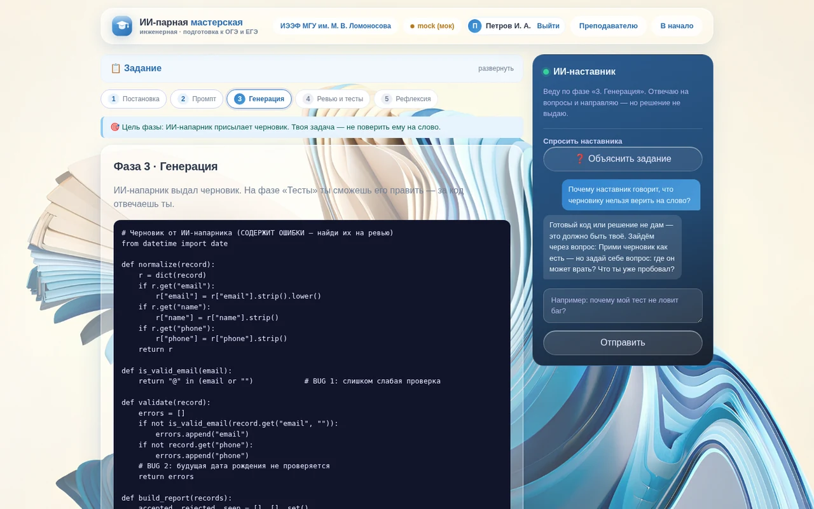
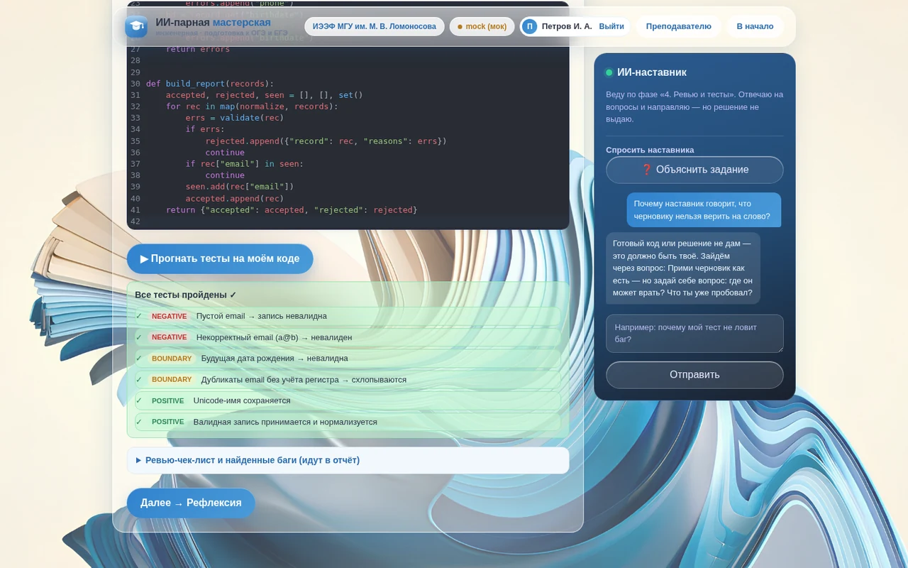
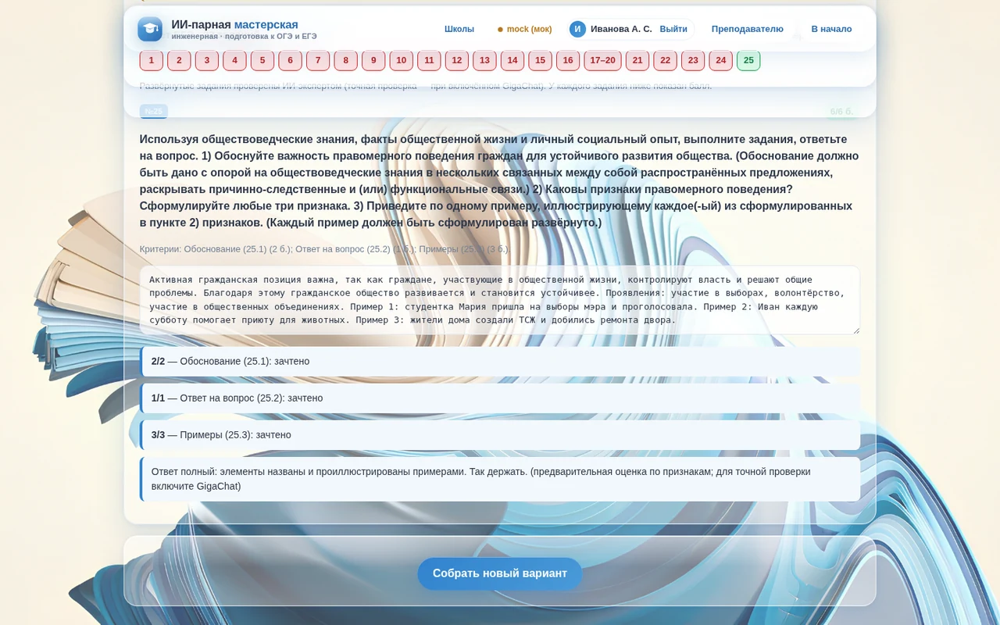
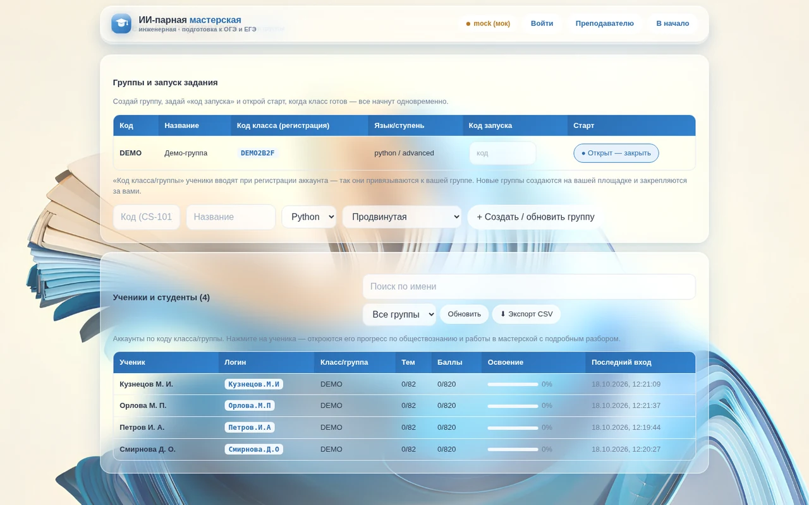

## Задача

ИИ в обучении обычно либо решает задачу за ученика, либо проверяет сам себя, и тогда оценке нельзя доверять. Нужна платформа, где ИИ ведёт по материалу, но не подсказывает готовый ответ, а результат оценивается объективно и по прозрачным критериям.

## Решение

Вокруг каждого обучающегося работает команда агентов с **разделением ролей «исполнитель ↔ оценщик»**. Агент, который помогает, никогда не оценивает свою же работу.

- **Напарник** пишет черновик решения, иногда с ошибками, чтобы студент учился ревью.
- **Наставник** ведёт по «лесенке подсказок». Защитный фильтр не даёт ему выдать готовый код.
- **Эксперт** независимо проверяет по официальным критериям, например ФИПИ для ЕГЭ.
- **Методист** строит индивидуальный план подготовки.
- **Репетитор** отвечает по базе знаний (RAG), опираясь на источники, а не на «память» модели.

Там, где можно, оценка опирается на объективные проверки: автопроверку тестовой части, прогон кода студента в песочнице, открытые и скрытые тесты.

### Архитектура

React‑интерфейс → REST API на FastAPI → агенты → LLM. База — SQLite через SQLModel. Платформа **мультиарендная**: у каждого учреждения своя изолированная площадка с программами, группами и данными. LLM подключается на выбор: GigaChat, любая OpenAI‑совместимая модель или встроенный офлайн‑режим для демонстраций без интернета.

## Моя роль

Основатель и технический директор: концепция и архитектура мультиагентной системы, разработка бэкенда, фронтенда и ИИ‑агентов. Научный руководитель проекта — А. Л. Булгаков (ИЭЭФ МГУ).

## Результат

Рабочий прототип с площадками МГУ, РЭУ им. Плеханова, ИТМО, школ и ИЭЭФ МГУ. ОГЭ и ЕГЭ по обществознанию по структуре кодификатора ФИПИ, инженерные кейсы с парным программированием, кабинеты ученика, преподавателя и администратора, 46 автотестов.

<!-- TODO: этап проекта — пилоты, пользователи, планы запуска -->
